<div align="center">



</div>

```console
mateus@buenno0:~$ cat contato.txt
```

<p align="center">
  <a href="https://linkedin.com/in/mateus-bueno-silva1"></a>
  <a href="https://viunacidade.com.br"></a>
  <a href="https://github.com/Buenno0/viunacidade"></a>
 
  <a href="mailto:mat.bueno7@icloud.com"></a>

</p>
